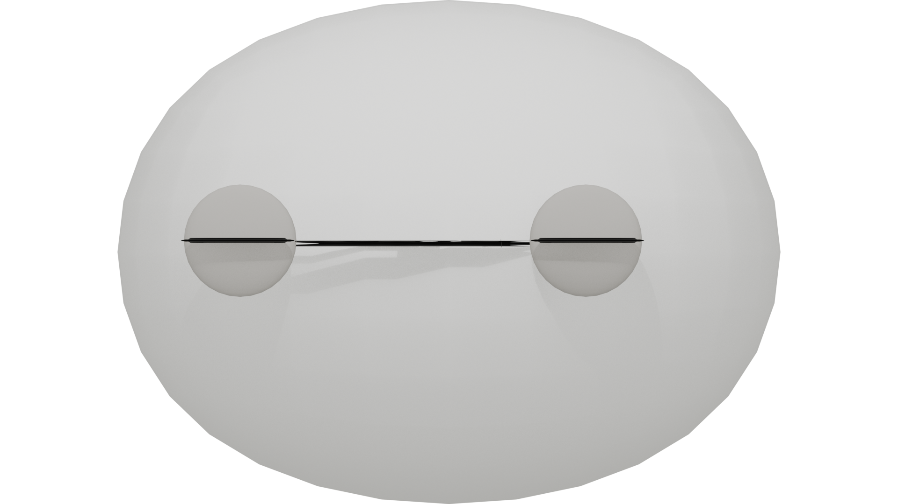
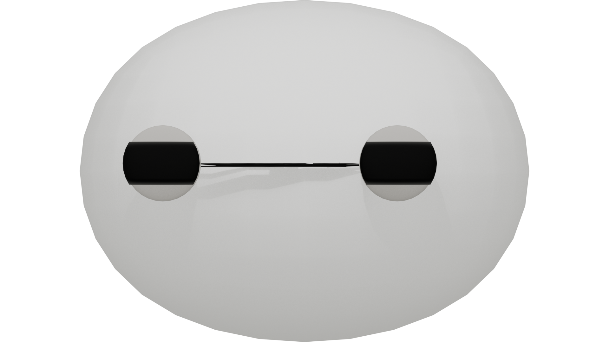
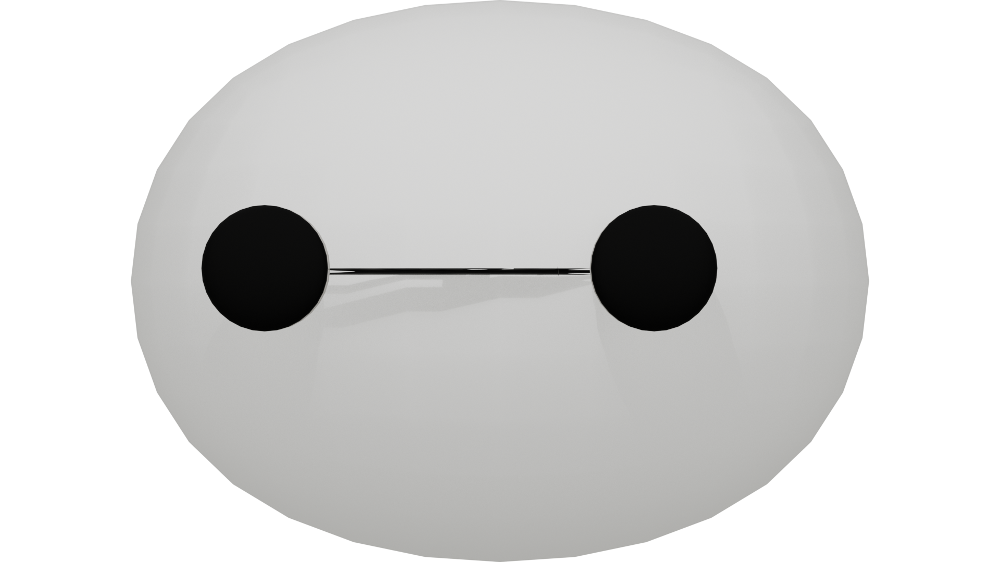

# 🤖 Baymax Health Companion（大白健康陪伴桌宠）

> 一个基于大语言模型的 **Agent 化桌面健康陪伴宠物**：有长期记忆、情绪感知、本地 RAG 医疗知识、定时提醒与传感关怀，外壳是一个会眨眼、会主动关心你的透明桌宠。
>
> *“你好，我是大白，你的私人健康助理。”*

<p align="center">
  
</p>

## ✨ 演示

| 休眠待机                                                   | 眯眼                                                      | 睁眼特写                                                   |
|--------------------------------------------------------|---------------------------------------------------------|--------------------------------------------------------|
|  |  |  |

## 🎯 项目简介

大白 v2 从一个 Pygame 命令行原型升级为 **PyQt6 桌面宠物**：透明置顶的大头停靠在桌面右下角，会缓慢闭眼休眠、被点击唤醒、眨眼卖萌；悬停时弹出一颗徽章按钮，点开就是横屏聊天面板（状态区 / 聊天 / 记忆芯片 / 提醒管理 / 设置）。核心是一套完整的**健康陪伴大脑**：

- **Agent 化**：智谱 GLM-4-Flash 原生 Function Calling，大白能自主决定调用本地工具（保存记忆 / 设定定时提醒 / 检索健康知识），不再只是“聊天机器人”。
- **双轨制情绪调度**：输入即时预判 + 大模型异步精准覆盖，表情与情绪实时联动。
- **7 状态有限状态机（FSM）**：休眠 / 问候 / 待机 / 聊天 / 关心 / 提醒 / 催促，事件驱动。
- **三层记忆机制**：短期对话窗口、长期记忆向量、往日摘要；来源分级（要求记住 > 主动记住 > 摘要记住），高优先级不覆盖。
- **本地 RAG 医疗知识**：Embedding 向量化 + NumPy 余弦相似度，语义检索（“天旋地转”能匹配“头晕”）。
- **传感关怀**：摔倒 / 心率异常 → 主动询问 + 结合记忆与健康知识库给出当下建议与就医指引（桌面按 `F` / `H` 模拟传感）。
- **提醒闭环**：到点口播 → 自动进聊天 → 完成 / 理由考察 / 闲聊三出口 → 5 分钟无回应自动重复提醒 → 催促开导。
- **固定话术人设**：招呼、告别（“我很满意你的服务”）、完成回应全部封装配置，非讨好型 AI，稳住形象。

## 🛠️ 技术栈

| 层 | 技术 |
|---|---|
| 语言 | Python 3.10（conda 环境） |
| 桌宠前端 | **PyQt6**（透明窗 / 无边框置顶 / QPropertyAnimation / 流式打字效果） |
| LLM | 智谱 **GLM-4-Flash**（对话 + Function Calling） |
| 向量 | 智谱 **Embedding-3**（本地 RAG 语义检索） |
| 编排 | LangChain LCEL（双轨制调度：Pass1 聊天 / Pass2 情绪动作） |
| 记忆存储 | SQLite3（7 表：用户画像 / 记忆点 / 健康日志 / 聊天 / 摘要 / 提醒 / 知识库） |
| 并发 | Threading + Queue 三队列（事件 / 动作 / 情绪），Qt 信号跨线程安全 |
| 表情渲染 | 21 帧 Blender 渲染序列帧，帧语义 0=睁 / 5=半 / 10=闭 / 20=上限 |
| 命令行版 | Pygame（`main.py`，W/F/H/T 键盘模拟传感器） |

## 🧠 核心架构

```
┌────────────── 桌面宠物层（PyQt6）──────────────┐
│  透明大头窗(表情引擎)  徽章(上抛动画)  聊天面板  │
│  状态区: 状态/情绪/记忆命中/动作  设置(白名单)  │
└──────────────┬───────────────────────────────┘
               │ 输出回调(on_output/on_chunk/on_chat_done)
┌──────────────▼───────────────────────────────┐
│            FSM 适配器（QTimer 100ms 驱动）     │
│   唤醒→问候→待机/聊天/关心/提醒/催促 状态机     │
└──────────────┬───────────────────────────────┘
               │ handle_event / get_pending_emotion / action_queue
┌──────────────▼───────────────┐  ┌──────────▼──────────────┐
│  大脑 brain.py（Agent 循环）  │  │  记忆 memory.py（SQLite）│
│  bind_tools + TOOL_REGISTRY  │──▶│  三层记忆/来源分级/RAG  │
│  最多5轮工具调用→出人话       │  │  向量相似度检索         │
└──────┬──────────┬────────────┘  └────────────────────────┘
       │          │
┌──────▼───┐  ┌──▼───────────┐
│ 智谱GLM  │  │ 定时调度器     │
│ Flash    │  │ scheduler.py │
└──────────┘  └──────────────┘
```

## 🚀 快速启动

```bash
# 1. 安装依赖（建议 conda 环境）
conda create -n baymax python=3.10 -y
conda activate baymax
pip install -r requirements.txt

# 2. 配置 API Key：复制 config.example.py 为 config.py，填入智谱 API Key

# 3. 初始化/更新健康知识库
python tools/init_rag_db.py --clear
python tools/seed_health_kb.py

# 4. 启动桌宠版（推荐）
python desktop/run_pet.py
#   - 点击大白头 = 唤醒；悬停出徽章按钮 → 点开聊天面板
#   - 键盘模拟传感：W=用户唤醒 F=摔倒 H=心率异常 T=定时提醒

# 4b. 或启动命令行版（Pygame）
python main.py
#   - W/1 唤醒，F/H 传感，T 定时器，Space 输入对话
```

## 📁 目录结构

```
Baymax/
├── desktop/                  # 桌宠版（PyQt6）
│   ├── run_pet.py            # 入口：组装大头+面板+FSM适配器+调度器
│   ├── baymax_pet.py         # 透明大头窗 + 表情引擎 + 徽章上抛
│   ├── baymax_panel.py       # 横屏面板（状态区/导航/失焦自动隐藏）
│   ├── panel_pages.py        # 聊天/记忆/提醒三页
│   ├── fsm_adapter.py        # FSM→UI 适配器（状态驱动+输出通道）
│   └── settings_dialog.py    # 人设白名单设置
├── core/
│   ├── brain.py              # 双轨制调度 + Agent 工具循环 + 摘要
│   ├── state_machine.py      # 7 状态 FSM（输出回调抽象）
│   ├── memory.py             # SQLite 三层记忆 + RAG + 提醒
│   ├── scheduler.py          # 定时提醒调度线程
│   ├── tools.py              # Agent 工具说明书（记忆/提醒/知识库）
│   ├── rag.py                # 向量化与相似度
│   └── console.py            # 命令行标签输出
├── main.py                   # 命令行版入口（Pygame）
├── config.py                 # 固定话术 / 关键词 / 配置
├── prompts.py                # 提示词模板
├── assets/
│   ├── frames/               # Blender 渲染 21 帧（1920×1080 黑底）
│   ├── pet/frames_pet/       # flood-fill 抠图透明帧（保留黑眼睛）
│   └── demo/                 # 演示素材（README 用）
└── tools/                    # 素材预处理 / 知识库初始化 / 演示录制
```

## 🗺️ Roadmap

- 🟢 **阶段一（已杀青）**：纯软件原型——表情序列帧 + Pygame FSM + 双轨制 + 三层记忆 + 本地 RAG + 情绪驱动状态机 + 记忆防污染。
- 🟡 **阶段二（当前）**：Agent 化（Function Calling 工具）+ PyQt6 桌面宠物完整迁移（唤醒/传感/提醒/关怀全链路）。
- 🔵 **阶段三（规划）**：TTS 语音口播、麦克风语音输入、真实传感硬件（ESP32-S3 + MAX30102 + MPU6050）经 BLE 接入、一体手环（LVGL + 端侧小模型）。
